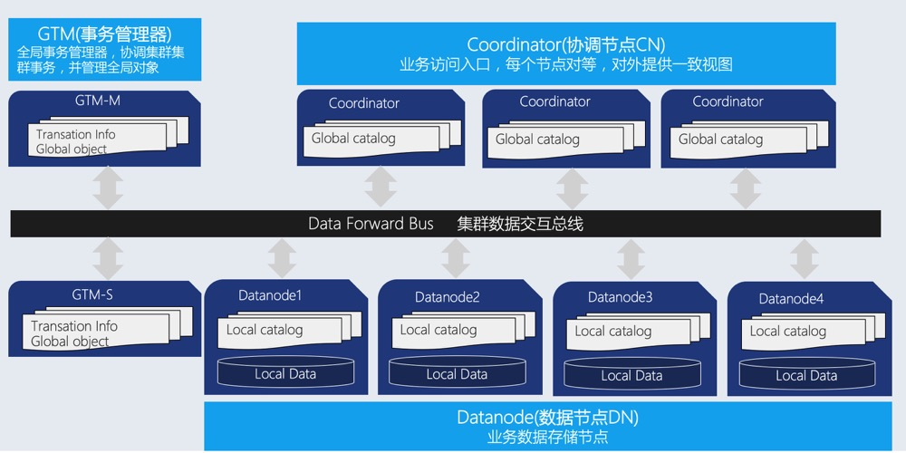
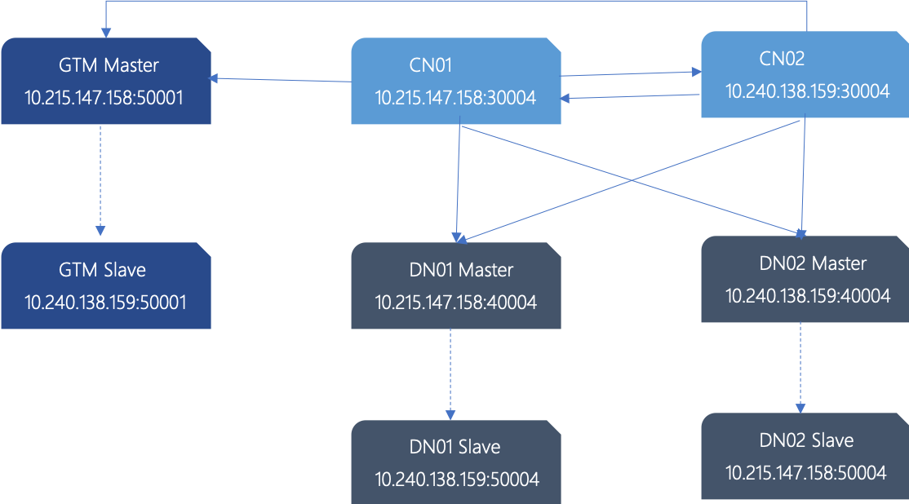

# 快速入门

## 什么是OpenTenBase

OpenTenBase 是一个提供写可靠性，多主节点数据同步的关系数据库集群平台。你可以将 OpenTenBase 配置一台或者多台主机上， OpenTenBase 数据存储在多台物理主机上面。数据表的存储有两种方式， 分别是 distributed 或者 replicated ，当向OpenTenBase发送查询 SQL时， OpenTenBase 会自动向数据节点发出查询语句并获取最终结果。

OpenTenBase 采用分布式集群架构（如下图）， 该架构分布式为无共享(share nothing)模式，节点之间相应独立，各自处理自己的数据，处理后的结果可能向上层汇总或在节点间流转，各处理单元之间通过网络协议进行通信，并行处理和扩展能力更好，这也意味着只需要简单的x86服务器就可以部署 OpenTenBase 数据库集群



下面简单解读一下OpenTenBase的三大模块

- **Coordinator：协调节点（简称CN）**
	
	业务访问入口，负责数据的分发和查询规划，多个节点位置对等，每个节点都提供相同的数据库视图；在功能上CN上只存储系统的全局元数据，并不存储实际的业务数据。

- **Datanode：数据节点（简称DN）**
	
	每个节点还存储业务数据的分片在功能上，DN节点负责完成执行协调节点分发的执行请求。 
	
- **GTM:全局事务管理器(Global Transaction Manager)**

	负责管理集群事务信息，同时管理集群的全局对象，比如序列等。

接下来，让我们来看看如何从源码开始，完成到OpenTenBase集群环境的搭建。

## OpenTenBase源码编译安装

### 系统要求

内存: 最小 8G RAM

操作系统: TencentOS 2, TencentOS 3, OpenCloudOS 8.x, CentOS 7, CentOS 8, Ubuntu 18.04

### 依赖

``` 
yum -y install git sudo gcc make readline-devel zlib-devel openssl-devel uuid-devel bison flex cmake postgresql-devel libssh2-devel sshpass libcurl-devel libxml2-devel
```

或者

```
apt install -y git sudo gcc make libreadline-dev zlib1g-dev libssl-dev libossp-uuid-dev bison flex cmake libssh2-1-dev sshpass libxml2-dev language-pack-zh-hans
```

### 创建用户 'opentenbase'

```bash
# 1. 创建目录 /data
mkdir -p /data

# 2. 添加用户
useradd -d /data/opentenbase -s /bin/bash -m opentenbase # 添加用户 opentenbase

# 3. 设置密码
passwd opentenbase # 设置密码

# 4. 将用户添加到 wheel 组
# 对于 RedHat
usermod -aG wheel opentenbase
# 对于 Debian
usermod -aG sudo opentenbase

# 5. 为 wheel 组启用 sudo 权限（通过 visudo）
visudo 
# 然后取消注释 "% wheel" 行，保存并退出
```

### 编译

```bash
su - opentenbase
cd /data/opentenbase/
git clone https://github.com/OpenTenBase/OpenTenBase

export SOURCECODE_PATH=/data/opentenbase/OpenTenBase
export INSTALL_PATH=/data/opentenbase/install/

cd ${SOURCECODE_PATH}
rm -rf ${INSTALL_PATH}/opentenbase_bin_v5.0
chmod +x configure*
./configure --prefix=${INSTALL_PATH}/opentenbase_bin_v5.0 --enable-user-switch --with-libxml --disable-license --with-openssl --with-ossp-uuid CFLAGS="-g"
make clean
make -sj
make install
chmod +x contrib/pgxc_ctl/make_signature
cd contrib
make -sj
make install
```

## 安装
使用 OPENTENBASE\_CTL 工具来搭建一个集群，例如：搭建一个具有1个全局事务管理节点(GTM)、1个协调器节点(COORDINATOR)以及2个数据节点(DATANODE)的集群。
  
### 准备工作

#### 1. 安装 opentenbase 并将 opentenbase 安装包的路径导入到环境变量中。

```shell
PG_HOME=${INSTALL_PATH}/opentenbase_bin_v5.0
export PATH="$PATH:$PG_HOME/bin"
export LD_LIBRARY_PATH="$LD_LIBRARY_PATH:$PG_HOME/lib"
export LC_ALL=C
```

#### 2. 禁用 SELinux 和防火墙（可选）

```
vi /etc/selinux/config 
set SELINUX=disabled

# 禁用防火墙
sudo systemctl disable firewalld
sudo systemctl stop firewalld
```

#### 3. 创建用于初始化实例的 *.tar.gz 包。

```
cd ${PG_HOME}
tar -zcf ${INSTALL_PATH}/opentenbase-5.21.8-i.x86_64.tar.gz *
cd ${INSTALL_PATH}
```

### 集群启动步骤

#### 生成并填写配置文件 
opentenbase\_config.opentenbase\_ctl 工具可以生成配置文件的模板。您需要在模板中填写集群节点信息。启动 opentenbase\_ctl 工具后，将在当前用户的主目录中生成 opentenbase\_ctl 目录。输入 "prepare config" 命令后，将在 opentenbase\_ctl 目录中生成可直接修改的配置文件模板。

* opentenbase\_config.ini 中各字段说明
```
| 配置类别        | 配置项            | 说明                                                                      |
|----------------|------------------|---------------------------------------------------------------------------||
| instance       | name             | 实例名称，可用字符：字母、数字、下划线，例如：opentenbase_instance01        |
|                | type             | distributed 表示分布式模式，需要 gtm、coordinator 和 data 节点；centralized 表示集中式模式 |
|                | package          | 软件包。完整路径（推荐）或相对于 opentenbase_ctl 的相对路径                  |
| gtm            | master           | 主节点，只有一个 IP                                                        |
|                | slave            | 从节点。如果需要 n 个从节点，在此配置 n 个 IP，用逗号分隔                    |
| coordinators   | master           | 主节点 IP，自动生成节点名称，在每个 IP 上部署 nodes-per-server 个节点        |
|                | slave            | 从节点 IP，数量是主节点的整数倍                                             |
|                |                  | 示例：如果 1 主 1 从，IP 数量与主节点相同；如果 1 主 2 从，IP 数量是主节点的两倍 |
|                | nodes-per-server | 可选，默认 1。每个 IP 上部署的节点数。示例：主节点有 3 个 IP，配置为 2，则有 6 个节点 |
|                |                  | cn001-cn006 共 6 个节点，每个服务器分布 2 个节点                            |
| datanodes      | master           | 主节点 IP，自动生成节点名称，在每个 IP 上部署 nodes-per-server 个节点        |
|                | slave            | 从节点 IP，数量是主节点的整数倍                                             |
|                |                  | 示例：如果 1 主 1 从，IP 数量与主节点相同；如果 1 主 2 从，IP 数量是主节点的两倍 |
|                | nodes-per-server | 可选，默认 1。每个 IP 上部署的节点数。示例：主节点有 3 个 IP，配置为 2，则有 6 个节点 |
|                |                  | dn001-dn006 共 6 个节点，每个服务器分布 2 个节点                            |
| server         | ssh-user         | 远程命令执行用户名，需要提前创建，所有服务器应有相同账户以简化配置管理          |
|                | ssh-password     | 远程命令执行密码，需要提前创建，所有服务器应有相同密码以简化配置管理            |
|                | ssh-port         | SSH 端口，所有服务器应保持一致以简化配置管理                                 |
| log            | level            | opentenbase_ctl 工具执行的日志级别（不是 opentenbase 节点的日志级别）        |

```

#### 1. 为实例创建配置文件 opentenbase\_config.ini
```
mkdir -p ./logs
touch opentenbase_config.ini
vim opentenbase_config.ini
```

* 例如，如果我有两台服务器 172.16.16.49 和 172.16.16.131，分布在两台服务器上的典型分布式实例配置如下。您可以复制此配置信息并根据您的部署要求进行修改。不要忘记填写 ssh 密码配置。
```
# 实例配置
[instance]
name=opentenbase01
type=distributed
package=/data/opentenbase/install/opentenbase-5.21.8-i.x86_64.tar.gz

# GTM 节点
[gtm]
master=172.16.16.49
slave=172.16.16.50,172.16.16.131

# 协调器节点
[coordinators]
master=172.16.16.49
slave= 172.16.16.131
nodes-per-server=1

# 数据节点
[datanodes]
master=172.16.16.49,172.16.16.131
slave=172.16.16.131,172.16.16.49
nodes-per-server=1

# 登录和部署账户
[server]
ssh-user=opentenbase
ssh-password=
ssh-port=36000

# 日志配置
[log]
level=DEBUG
```


* 同样，典型集中式实例的配置如下。不要忘记填写 ssh 密码配置。
```
# 实例配置
[instance]
name=opentenbase02
type=centralized
package=/data/opentenbase/install/opentenbase-5.21.8-i.x86_64.tar.gz

# 数据节点
[datanodes]
master=172.16.16.49
slave=172.16.16.131
nodes-per-server=1

# 登录和部署账户
[server]
ssh-user=opentenbase
ssh-password=
ssh-port=36000

# 日志配置
[log]
level=DEBUG
```

#### 2. 执行实例安装命令。

```
export LD_LIBRARY_PATH=/data/opentenbase/install/opentenbase_bin_v5.0/lib
./opentenbase_bin_v5.0/bin/opentenbase_ctl install  -c opentenbase_config.ini

====== Start to Install Opentenbase test_cluster01  ====== 

step 1: Make *.tar.gz pkg ...
    Make opentenbase-5.21.8-i.x86_64.tar.gz successfully.

step 2: Transfer and extract pkg to servers ...
    Package_path: /data/opentenbase/opentenbase_ctl/opentenbase-5.21.8-i.x86_64.tar.gz
    Transfer and extract pkg to servers successfully.

step 3: Install gtm master node ...
    Install gtm0001(172.16.16.49) ...
    Install gtm0001(172.16.16.49) successfully
    Success to install  gtm master node. 

step 4: Install cn/dn master node ...
    Install cn0001(172.16.16.49) ...
    Install dn0001(172.16.16.49) ...
    Install dn0002(172.16.16.131) ...
    Install cn0001(172.16.16.49) successfully
    Install dn0001(172.16.16.49) successfully
    Install dn0002(172.16.16.131) successfully
    Success to install all cn/dn master nodes. 

step 5: Install slave nodes ...
    Install gtm0002(172.16.16.131) ...
    Install cn0001(172.16.16.131) ...
    Install dn0001(172.16.16.131) ...
    Install dn0002(172.16.16.49) ...
    Install gtm0002(172.16.16.131) successfully
    Install dn0002(172.16.16.49) successfully
    Install dn0001(172.16.16.131) successfully
    Install cn0001(172.16.16.131) successfully
    Success to install all slave nodes. 

step 6: Create node group ...
    Create node group successfully. 

====== Installation completed successfully  ====== 
```
* 当您看到 'Installation completed successfully' 字样时，表示安装已完成。尽情享受您的 opentenbase 之旅吧。
* 您可以检查实例的状态
```
[opentenbase@VM-16-49-tencentos opentenbase_ctl]$ ./opentenbase_bin_v5.0/bin/opentenbase_ctl status -c opentenbase_config.ini

------------- Instance status -----------  
Instance name: test_cluster01
Version: 5.21.8

-------------- Node status --------------  
Node gtm0001(172.16.16.49) is Running 
Node dn0001(172.16.16.49) is Running 
Node dn0002(172.16.16.49) is Running 
Node cn0001(172.16.16.49) is Running 
Node dn0002(172.16.16.131) is Running 
Node cn0001(172.16.16.131) is Running 
Node gtm0002(172.16.16.131) is Running 
Node dn0001(172.16.16.131) is Running 
[Result] Total: 8, Running: 8, Stopped: 0, Unknown: 0

------- Master CN Connection Info -------  
[1] cn0001(172.16.16.49)  
Environment variable: export LD_LIBRARY_PATH=/data/opentenbase/install/opentenbase/5.21.8/lib  && export PATH=/data/opentenbase/install/opentenbase/5.21.8/bin:${PATH} 
PSQL connection: psql -h 172.16.16.49 -p 11000 -U opentenbase postgres 
```

## 使用
* 连接到 CN 主节点执行 SQL

```
export LD_LIBRARY_PATH=/home/opentenbase/install/opentenbase/5.21.8/lib  && export PATH=/home/opentenbase/install/opentenbase/5.21.8/bin:${PATH} 
$ psql -h ${CoordinateNode_IP} -p ${CoordinateNode_PORT} -U opentenbase -d postgres

postgres=# create database test;
CREATE DATABASE
postgres=# create user test with password 'test';
CREATE ROLE
postgres=# alter database test owner to test;
ALTER DATABASE
postgres=# \c test test
You are now connected to database "test" as user "test".
test=> create table foo(id bigint, str text) distribute by shard(id);
CREATE TABLE
test=> insert into foo values(1, 'tencent'), (2, 'shenzhen');
COPY 2
test=> select * from foo;
 id |   str    
----+----------
  1 | tencent
  2 | shenzhen
(2 rows)

```

### SQL 示例逐条讲解

上例输入共 7 条：`\c test test` 是 psql 元命令（非 SQL），其余 6 条为 SQL。下文详解建表、插入、查询 3 条，建库/建用户/改属主见下文速览表。凡标注 **预期结果** 的内容为架构推导，未在真实集群执行；SQL 文本与回显逐字对照上方示例。

#### ① `create table foo(id bigint, str text) distribute by shard(id);`

**逐步拆解**

| 片段 | 含义 |
|---|---|
| `create table foo` | 在数据库 `test` 中创建表 `foo` |
| `id bigint` | 列 `id`，类型 bigint（8 字节有符号整数，约 ±9.2×10¹⁸） |
| `str text` | 列 `str`，类型 text（变长字符串） |
| `distribute by shard(id)` | **OpenTenBase 特有**：分布键为 `id`，每行按 id 哈希落到某个 DN 的分片 |

**集群视角（预期结果，CN/DN/GTM 角色见文档开头「三大模块」）**：建表只登记 CN 上的全局元数据；写入的数据按 `id` 哈希分布到各 DN——即文档开头两种存储方式之一 **distributed（分片）**：

| 存储方式 | 写法 | 存放方式 | 场景 |
|---|---|---|---|
| distributed（分片） | `distribute by shard(id)` | 每行按分布键哈希存于一个 DN 的分片 | 大业务表 |
| replicated（复制） | `distribute by replication` | 整表在每个 DN 各存一份副本 | 小维表 / 配置表 |

分布键建议（预期结果）：用最常过滤/连接的列做分布键，`where id=...` 可路由到单个 DN；不带分布键的查询需全部 DN 参与。

**语法标注**

```text
create table foo ( id  bigint , str  text ) distribute by shard ( id );
  ①建表   ②表名  ③列名 ④类型  ⑤列名 ⑥类型   ⑦分布子句   ⑧分布键
                 └── 列定义列表（逗号分隔）──┘
```

#### ② `insert into foo values(1, 'tencent'), (2, 'shenzhen');`

**逐步拆解**

| 片段 | 含义 |
|---|---|
| `insert into foo` | 向表 `foo` 写入数据 |
| `values(1,'tencent'), (2,'shenzhen')` | 一次 2 行：第 1 行 id=1、str='tencent'；第 2 行 id=2、str='shenzhen'。未写列名，按建表列序（id, str）一一对应 |
| 返回 `COPY 2` | 2 行写入成功 |

**语法标注**

```text
insert into foo values ( 1 , 'tencent' ), ( 2 , 'shenzhen' );
 ①插入   ②表名     ③第1行 id=1、str='tencent'  ④第2行 id=2、str='shenzhen'
                    └── 多行之间用逗号分隔 ──┘
```

回显 `COPY 2` 而非标准 PostgreSQL 的 `INSERT 0 2`，请以你所在版本的实测输出为准；两种写法都表示“成功写入 2 行”，对照说明见下文「新手原本不易理解的例子」。

#### ③ `select * from foo;`

**逐步拆解**

| 片段 | 含义 |
|---|---|
| `select *` | 选取所有列（id、str） |
| `from foo` | 查询对象是分片表 `foo` |

**执行流程（预期结果，按文档开头架构图推导）**

```text
客户端 ──SQL──▶ CN（解析、生成计划）
                │ 并行下发
                ▼
       DN1 分片     DN2 分片   （各自只算自己的分片）
                ▼
           结果合并回 CN ──▶ 客户端
```

输出 2 行。示例中顺序恰好同插入顺序，但**无 `ORDER BY` 时分片表行序不保证**，需稳定顺序应写 `select * from foo order by id;`（预期结果）。

#### 附带 3 条语句速览

| 输入 | 是什么 | 说明 |
|---|---|---|
| `create database test;` | SQL（DDL） | 建库 `test`。数据库是全局元数据，由 CN 统一管理、各 CN 视图相同 |
| `create user test with password 'test';` | SQL（DDL） | 建可登录角色 `test`（`create user` ≡ `create role ... login`），全集群生效 |
| `alter database test owner to test;` | SQL（DDL） | 把 `test` 库的属主改为用户 `test` |
| `\c test test` | **psql 元命令（非 SQL）** | 以 `test` 用户连 `test` 库；提示符 `postgres=#`（超管）→ `test=>`（普通用户） |

#### 新手原本不易理解的例子：原版 vs 改进版

原版（上方示例原文摘录）：

```text
test=> insert into foo values(1, 'tencent'), (2, 'shenzhen');
COPY 2
```

新手第一反应：执行的是 INSERT，为何回显 COPY？是不是抄错了？

改进后的说明：

```text
test=> insert into foo values(1, 'tencent'), (2, 'shenzhen');
COPY 2
   ▲ └─ 2：成功写入 2 行
   └── COPY：OpenTenBase 底层用批量复制通道向各 DN 分发数据的回显风格
        （等价于标准 PostgreSQL 的 INSERT 0 2；并非执行了 COPY 命令）
```

一句话记住：**看到 `COPY n` 就当作“写入了 n 行”。**

#### 小练习（答案均为预期结果，未实际执行）

* **练习 1**：建一个与 `foo` 同结构的复制表 `bar`，怎么写？
  预期结果：`create table bar(id bigint, str text) distribute by replication;`
* **练习 2**：`select * from foo where id = 1;` 涉及哪些节点？
  预期结果：CN 按 id=1 的哈希定位到唯一 DN，仅向该 DN 下发——这正是分布键的路由收益。
* **练习 3**：连续两次执行 `select * from foo;`，输出顺序一定相同吗？
  预期结果：不一定。加 `order by id;` 才能稳定输出。
* **练习 4**：一次插入 `(3,'beijing'),(4,'shanghai'),(5,'guangzhou')` 三行，回显是什么？
  预期结果：`COPY 3`。

#### 核对与试读说明

* 上述 SQL 与回显（`CREATE TABLE`、`COPY 2`、`(2 rows)` 等）逐字对照本页示例原文，一致；架构推导均标注「预期结果」。
* 自查说明：缩写 CN/DN 在本页开头「三大模块」已给出定义，讲解与此保持一致；示例输入共 7 条（6 条 SQL + 1 条 psql 元命令），已按此表述。


- **结语**	
    本文档只是给用户一个简单的指引，演示如何从源码开始，一步一步搭建一个完整的OpenTenBase集群，后续会有更多的文章来介绍OpenTenBase的特性使用，优化，问题定位等内容。
