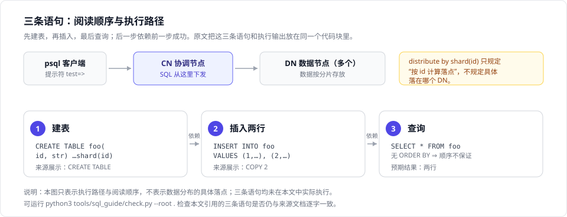

# 读懂第一条 SQL：建表、插入与查询

> 本文伴读[快速入门](01-quickstart.md)的“使用”小节。那里给出了三条 SQL 和它们的执行输出，但没有逐条说明每条语句在做什么。本文按“建表 → 插入 → 查询”的顺序把这三条拆开讲清楚。
>
> 本文不新增 SQL，也不改写原文中的 SQL。标为“来源文档展示”的输出是原文照录，不是实测结果。

## 先分清三种提示符

原文的代码块里混着三类行：shell 命令、SQL 语句、执行输出。它们的区别看行首：

| 行首 | 是什么 | 原文例子 |
|---|---|---|
| `$` | 操作系统 shell 提示符，后面是 shell 命令 | `$ psql -h ${CoordinateNode_IP} ...` |
| `postgres=#` | psql 提示符，当前连的是 `postgres` 库；`#` 表示超级用户 | `postgres=# create database test;` |
| `test=>` | psql 提示符，执行 `\c test test` 之后已切到 `test` 库；`>` 表示普通用户 | `test=> select * from foo;` |
| 无提示符 | 上一条语句的执行输出 | `CREATE TABLE`、`(2 rows)` |

复制示例时只复制提示符后面的部分。把 `test=>` 一起粘进 psql，会得到一个语法错误，而不是执行结果。

## 前置条件

三条语句依赖原文前一段的准备工作，按顺序是：

1. 集群已启动，并且能通过 CN（协调节点）连接。
2. 已建库和用户，并把库的属主交给该用户：原文执行 `create database test;`、`create user test ...`、`alter database test owner to test;`。
3. 已切换到目标库：原文执行 `\c test test`，之后提示符才从 `postgres=#` 变成 `test=>`。

这也是下文三条语句的提示符都是 `test=>` 的原因：它们是在 `test` 库里、以普通用户 `test` 的身份执行的。

> 原文的建用户示例使用了一个演示用的简单口令。它只适合一次性演示环境，不要复制到任何真实部署中；真实环境请使用符合口令策略的强口令。

## 第一步：建表

**用途**：在 `test` 库里建一张名为 `foo` 的表，并指定按 `id` 列分布数据。

**原文语句**：

<!-- sql-guide-example: create-foo-table -->
```sql
create table foo(id bigint, str text) distribute by shard(id);
```

**逐段拆解**：

| 片段 | 含义 |
|---|---|
| `create table foo` | 建表，表名 `foo` |
| `(id bigint, str text)` | 两个列：`id` 是 64 位整数，`str` 是变长文本 |
| `distribute by shard(id)` | OpenTenBase 的分布子句，按 `id` 列的值决定每一行落到哪个 DN（数据节点） |

**关于 `distribute by shard(id)`**：这是 OpenTenBase 在标准 SQL 之外提供的语法，用来描述数据在多个 DN 之间怎么分。理解它时有三个容易过头的地方：

- 它不是 PostgreSQL 或 MySQL 的通用写法，照搬到别的数据库会报错。
- “按 `id` 分布”不等于“每个 `id` 独占一个节点”，也不等于“两行数据一定落在两个不同的 DN”。
- 不能只凭插入的行数推断分布结果。某一行实际落在哪个 DN，取决于分布键的取值和节点数量。

**前置条件**：已按上文完成建库、建用户并切换到 `test` 库。

**来源文档展示**：紧跟这条语句，原文给出的标签是 `CREATE TABLE`。

**常见误解**：

- 把 `distribute by shard(id)` 理解成索引或分区。它是数据的分布方式，不创建索引。
- 以为这段建表语句能直接在单机 PostgreSQL 上运行。它依赖 OpenTenBase 的集群能力。
- 以为两行数据必然分散在不同节点。分布是按下标值计算的，和插入了几行没有关系。

**来源**：`docs/guide/01-quickstart.md`（固定提交 `4eaeba90188926ddf4da23b74775cdf150ffdfe8`），“使用”小节代码块中，`\c test test` 之后的第一条 `test=>` 语句。[在固定提交上查看](https://github.com/OpenTenBase/docs/blob/4eaeba90188926ddf4da23b74775cdf150ffdfe8/docs/guide/01-quickstart.md)

## 第二步：插入

**用途**：向 `foo` 一次插入两行数据。

**原文语句**：

<!-- sql-guide-example: insert-foo-rows -->
```sql
insert into foo values(1, 'tencent'), (2, 'shenzhen');
```

**逐段拆解**：

| 片段 | 含义 |
|---|---|
| `insert into foo` | 向 `foo` 表插入 |
| `values(1, 'tencent'), (2, 'shenzhen')` | 两组括号就是两行，逗号分隔 |
| `1`、`2` | 对应 `id` 列（整数，不加引号） |
| `'tencent'`、`'shenzhen'` | 对应 `str` 列（字符串，用单引号） |

**为什么不写列清单**：这条语句省略了 `(id, str)`。省略时，`values` 里的值按建表时的列顺序依次匹配，所以第一个值进 `id`，第二个值进 `str`。写全列清单更不容易出错，但原文示例没有写，本文不改写它。

**前置条件**：`foo` 表已存在，即第一步已成功。否则插入会失败。

**来源文档展示**：紧跟这条语句，原文给出的标签是 `COPY 2`。

> 说明：`COPY 2` 是原文给出的标签，这里照录。如果你在自己的环境里执行，以实际输出为准。

**常见误解**：

- 把两组括号当成一行两列。这里一个括号是一行，两个括号是两行，每行两列。
- 用双引号写字符串。SQL 里双引号是标识符，字符串必须用单引号。
- 以为值的个数可以随意。`values` 每组的值的数量必须和表的列数对应。

**来源**：`docs/guide/01-quickstart.md`（固定提交 `4eaeba90188926ddf4da23b74775cdf150ffdfe8`），“使用”小节代码块中，建表语句之后的第一条 `test=>` 语句。[在固定提交上查看](https://github.com/OpenTenBase/docs/blob/4eaeba90188926ddf4da23b74775cdf150ffdfe8/docs/guide/01-quickstart.md)

## 第三步：查询

**用途**：把 `foo` 里的数据读出来，确认前两步的结果。

**原文语句**：

<!-- sql-guide-example: select-foo-all -->
```sql
select * from foo;
```

**逐段拆解**：

| 片段 | 含义 |
|---|---|
| `select` | 查询 |
| `*` | 返回表里的全部列（这里就是 `id` 和 `str` 两列） |
| `from foo` | 从 `foo` 表读取 |

**预期结果**（来源文档展示）：原文给出的结果是一个两列表格，内容如下。

| id | str |
|---|---|
| 1 | tencent |
| 2 | shenzhen |

这里必须说清三点：

- 本文没有实际执行这条查询，上表是**预期结果**，来源是原文展示。
- `select *` 返回的是全部列，不是“全部数据”这个意义上的一切；本例恰好返回全部两行。
- 这条语句**没有 `ORDER BY`**，所以不保证任何返回顺序。原文展示的 `1`、`2` 顺序只是那次展示的顺序，不是可以依赖的契约。需要固定顺序时必须显式写 `ORDER BY`。

**前置条件**：`foo` 表已存在且有数据，即前两步都已成功。

**来源文档展示**：原文在结果表格后给出 `(2 rows)`，表示返回两行。

**常见误解**：

- 以为没有 `ORDER BY` 也会按插入顺序返回。不保证。
- 以为 `select *` 是推荐写法。列结构变化会让下游消费方受影响，正式查询建议写出需要的列名。
- 以为查询结果为空的表和报错是一回事。空表返回 0 行，不是错误。

**来源**：`docs/guide/01-quickstart.md`（固定提交 `4eaeba90188926ddf4da23b74775cdf150ffdfe8`），“使用”小节代码块中的第三条 `test=>` 语句。[在固定提交上查看](https://github.com/OpenTenBase/docs/blob/4eaeba90188926ddf4da23b74775cdf150ffdfe8/docs/guide/01-quickstart.md)

## 把三条连起来看



先看图的上半部分：客户端连到 CN，CN 再把语句下发到各个 DN，返回的数据由 CN 汇总给客户端。再看下半部分：三步是一条链，建表拿到表结构，插入才有地方放数据，查询才有内容可读；任何一步失败，后面两步都做不下去。

图中的 `distribute by shard(id)` 只规定“由 `id` 计算落点”，具体落在哪个 DN 取决于分片规则和节点数量，所以图上没有把某一行画到某个具体节点。

| 顺序 | 语句作用 | 依赖 | 来源文档展示的输出 |
|---|---|---|---|
| 第一步 | 建表 `foo`，两列，按 `id` 分布 | 已建库、建用户、切到 `test` 库 | `CREATE TABLE` |
| 第二步 | 插入两行数据 | `foo` 已存在 | `COPY 2` |
| 第三步 | 读出全部列 | `foo` 已存在且有数据 | 两行结果、`(2 rows)` |

三步是严格的先后关系：建表失败，插入必然失败；插入失败，查询会得到空结果而不是两行。

## 校验这三条语句有没有和原文走样

`docs/guide/first-three-sql.md`（也就是本文）里的三条 SQL 是逐字引用原文的。为了避免日后维护时原文改了、伴读没跟上，仓库里带了一个离线校验工具：

```
python3 tools/sql_guide/check.py --root .
```

它只做一件事：检查本文中标记的三条语句与 `docs/guide/01-quickstart.md` 里的原文是否仍然逐字一致。它不联网、不连数据库、不执行任何 SQL。

它的通过只说明**引用没有漂移**，不说明本文的技术解释正确，也不说明这三条语句在你的环境里能跑通。使用方法、退出码和已知限制见仓库内 `tools/sql_guide/README.md`。

## 下一步读什么

按下面的顺序继续，每条都说明了它适合解决什么问题：

1. [快速入门](01-quickstart.md)：回到原文，确认集群部署步骤和这三条语句的上下文。
2. [应用接入指南](02-access.md)：用 Java、C、shell、Python、PHP 或 Go 连接 OpenTenBase。
3. [基本使用](03-basic-use.md)：继续学建库、建表、数据导入和更复杂的查询。
4. [用户管理](07-user-rights.md)：理解本文示例里的 `test` 用户、库属主和权限之间的关系。
5. [如何贡献 OpenTenBase](../contribution/how-to.md)：发现文档问题或有改进建议时，提 issue 或 PR 的流程。

## 这一页覆盖到哪里

- 只讲上面这三条语句，不新增第四条，也不改写原文。
- 输出只有两种来源：原文照录，或由原文推导的预期结果；没有在集群上实跑。
- 性能调优、分布键怎么选、权限模型的细节，留给后面的章节。
- 如果你的环境跑出来和这里写的不一样，欢迎按上面第 5 个入口反馈。
